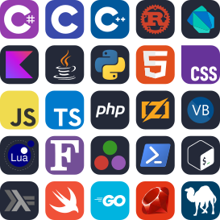
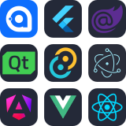
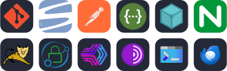
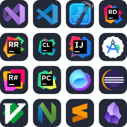
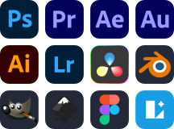
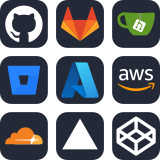

<!--

   
  
     

-->

<pre align="center">
██████╗ ██╗   ██╗███╗   ██╗███████╗███████╗███████╗██╗  ██╗███████╗██╗  ██╗   ██╗
██╔══██╗╚██╗ ██╔╝████╗  ██║██╔════╝██╔════╝██╔════╝██║  ██║██╔════╝██║  ╚██╗ ██╔╝
██║  ██║ ╚████╔╝ ██╔██╗ ██║█████╗  ███████╗███████╗███████║█████╗  ██║   ╚████╔╝ 
██║  ██║  ╚██╔╝  ██║╚██╗██║██╔══╝  ╚════██║╚════██║██╔══██║██╔══╝  ██║    ╚██╔╝  
██████╔╝   ██║   ██║ ╚████║███████╗███████║███████║██║  ██║███████╗███████╗██║   
╚═════╝    ╚═╝   ╚═╝  ╚═══╝╚══════╝╚══════╝╚══════╝╚═╝  ╚═╝╚══════╝╚══════╝╚═╝   
</pre>

   

<!-- https://github.com/DenverCoder1/readme-typing-svg -->

  

  

  
       
  <!-- https://github.com/anuraghazra/github-readme-stats -->
  <!--  -->
  
  <!-- https://github.com/DenverCoder1/github-readme-streak-stats -->
  <!--  -->
  
      
  <!-- https://github.com/Ashutosh00710/github-readme-activity-graph -->
  
      
  <!-- https://github.com/anuraghazra/github-readme-stats -->
  
  <!-- https://github.com/anuraghazra/github-readme-stats -->
  
      

 

  
       
  <h2 align="center">
    CEO & CTO of <a href="https://nimatattic.com" target="_blank">Nimatattic</a>
  </h2>
  

    I'm Dynesshely, a computer science enthusiast passionate about programming, software development, and technology.
     
    I enjoy exploring new technologies, learning new programming languages, and contributing to open-source projects.
     
    My goal is to create innovative solutions that make a positive impact on people's lives through technology.
     
    In addition, I am the chairman of the <a href="https://crequency.com" target="_blank">Crequency Open Source Organization</a>'s power committee.
     
    I will continue to lead Nimatattic and Crequency to explore the forefront of technology, strive to make technology accessible to the public, and maintain progress.
  

      

 

  
       
  <!-- https://github.com/LelouchFR/skill-icons -->
  
    
  
      
  
    
  
      
  
    
  
      
  
    
  
      
  
    
  
      
  
    
  
      
  
    
  
      
  
    
  
      
  
    
  
      
  
    
  
      
  
    
  
      
  
    
  
      
  
    
  
      
  
    
  
      
  
    
  

 

<!-- 

     
  
       
  
  
  
  
  
  
  
  

 -->

     
  
       
  
  
  

 

  

<!--

# 🌱 Learning and using

)

> By the way: I love `C#` at most

I have an organization account named [Hello Computer Science](https://github.com/Hello-Computer-Science) , which contains some repo for my learning experience.

-->
