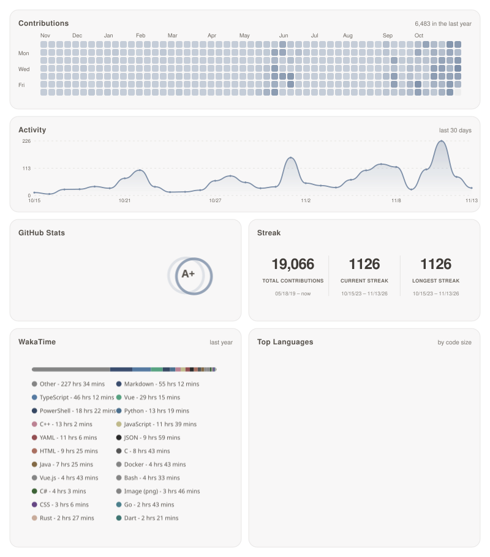

# Status panel preview

[`renderer/`](../renderer/README.md) composes the five cards of the main README
into a single 800px panel: contribution heatmap, GitHub stats, streak, WakaTime
and top languages - rendered by the vendored upstream renderers but laid out with
one shared design system (grid, radius, borders, typography, accent colour).

The main [`README.md`](../README.md) still shows the individual cards; this page
previews the composed variant so the two can be compared side by side.

<picture>
  <source media="(prefers-color-scheme: dark)" srcset="../assets/status-dark.svg">
  
</picture>

## How it is generated

```bash
cd renderer
npm ci
export PAT_1=$(gh auth token)   # the vendored github-readme-stats fetchers read PAT_1..PAT_n
node src/index.mjs
```

- Writes `assets/status.svg` (light) and `assets/status-dark.svg` (dark). The dark
  variant is selected with `<picture>` because `prefers-color-scheme` inside an SVG
  loaded as `` does not work.
- [`.github/workflows/readme-assets.yml`](../.github/workflows/readme-assets.yml)
  runs the same command on its five-hour schedule and commits the result whenever
  the bytes change.
- Which upstream code is copied verbatim, and which panels had to be ported
  (streak is a PHP app, the activity graph is a 1200px chartist line), is
  documented in [`renderer/README.md`](../renderer/README.md).

## Layout

```
+--------------------------------------------------------------+
| Contributions (heatmap, last year)                       5,892 |
+------------------------------+-------------------------------+
| GitHub Stats                 | Streak                        |
+------------------------------+-------------------------------+
| WakaTime                     | Top Languages                 |
+------------------------------+-------------------------------+
```
